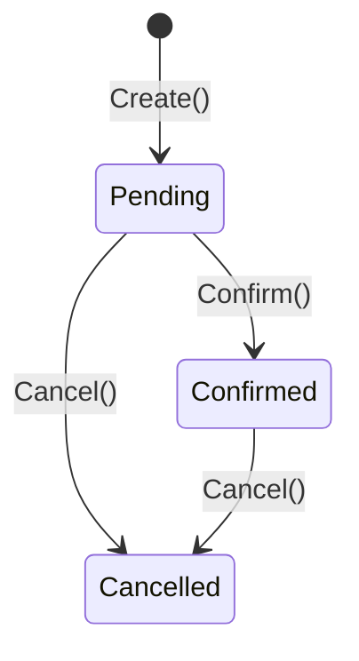
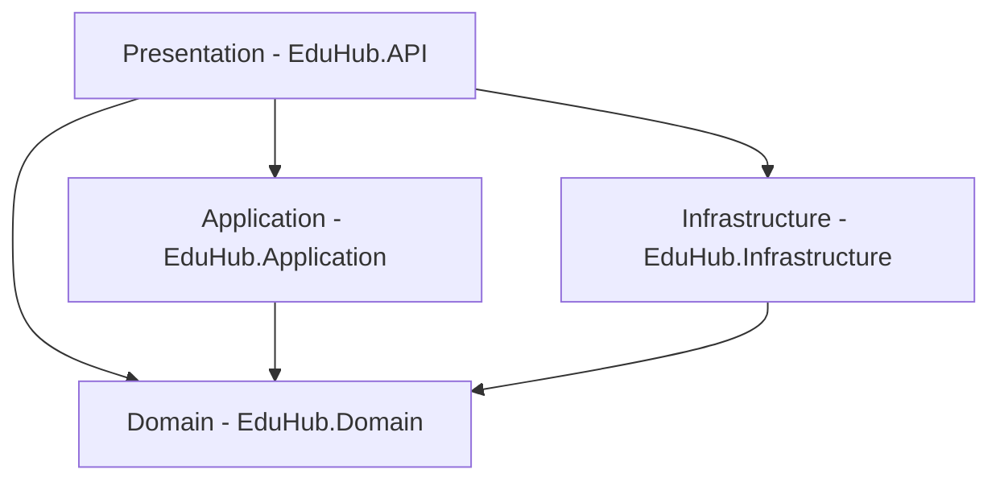

# BÀI KIỂM TRA GIỮA KỲ – IN4211

## Câu 1a

## Câu 1b
1. Id và Email có public set nên bên ngoài có thể
tự ý sửa dữ liệu, làm mất tính đóng gói.

2. Constructor public cho phép tạo Member
mà không kiểm tra email, dẫn đến dữ liệu không hợp lệ.

## Câu 2a

## Câu 3a

1. SRP (Single Responsibility Principle):
Vi phạm ở dòng 6–14 vì EventService vừa kiểm tra dữ liệu,
lưu sự kiện, ghi log và gửi thông báo.

2. OCP (Open/Closed Principle):
Vi phạm ở dòng 11–14 vì khi thêm kênh thông báo mới
phải sửa câu lệnh if/else trong EventService.

3. DIP (Dependency Inversion Principle):
Vi phạm ở dòng 8, 12 và 14 vì EventService phụ thuộc
trực tiếp vào SqlConnection, EmailSender và SmsSender
thay vì các interface.
## Câu 4b

- Git merge: Gộp thay đổi từ nhánh khác vào nhánh hiện tại,
giữ nguyên lịch sử commit.

- Git rebase: Chuyển các commit của nhánh hiện tại lên
trên một commit nền mới, giúp lịch sử tuyến tính hơn.

- Không nên dùng rebase trên nhánh đã chia sẻ với
người khác vì có thể làm thay đổi lịch sử commit,
gây xung đột khi làm việc nhóm.

## Câu 5a

- Domain: Event, IEventRepository.
- Application: EventService.
- Infrastructure: InMemoryEventRepository.
- Presentation: EventsController.

## Câu 5b
EduHub.Domain không được tham chiếu EduHub.Infrastructure
vì Domain là lớp lõi, chứa các quy tắc nghiệp vụ
và phải độc lập với công nghệ lưu trữ dữ liệu.

Nếu Domain phụ thuộc Infrastructure thì khi thay đổi
database có thể phải sửa cả Domain, vi phạm
Dependency Rule của Clean Architecture.
## Câu 5d