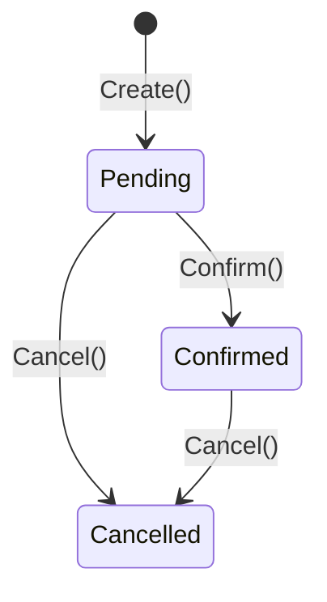

# BÀI KIỂM TRA GIỮA KỲ – IN4211

## Câu 1a

## Câu 1b
1. Id và Email có public set nên bên ngoài có thể
tự ý sửa dữ liệu, làm mất tính đóng gói.

2. Constructor public cho phép tạo Member
mà không kiểm tra email, dẫn đến dữ liệu không hợp lệ.

## Câu 2a

## Câu 3a

## Câu 4b

## Câu 5a

## Câu 5b

## Câu 5d