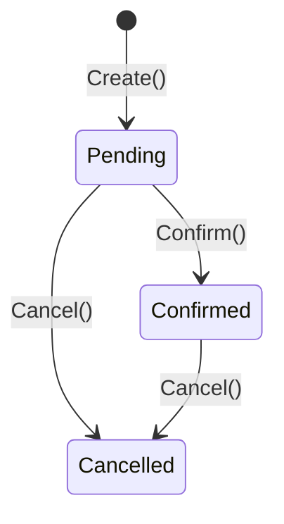
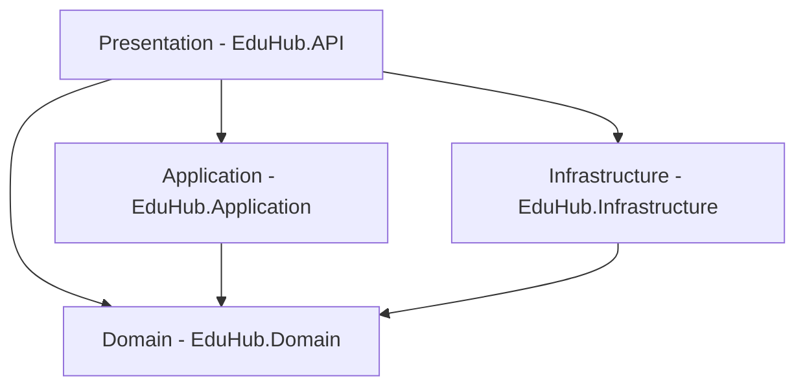

# BÀI KIỂM TRA GIỮA KỲ – IN4211

## Câu 1a

1. Tính đóng gói (Encapsulation): Giúp bảo vệ dữ liệu của đối tượng, không cho phép thay đổi trực tiếp từ bên ngoài mà phải thông qua các phương thức được quy định.

Tệp: EduHub.Domain/Entities/Registration.cs

Lớp: Registration

Minh họa: Các thuộc tính sử dụng private set để hạn chế việc thay đổi dữ liệu từ bên ngoài. Trạng thái đăng ký chỉ được thay đổi thông qua Confirm() và Cancel(), có kiểm tra điều kiện trước khi cập nhật.

2. Tính kế thừa (Inheritance): Cho phép một lớp kế thừa các thuộc tính và phương thức từ lớp khác, giúp tái sử dụng mã nguồn.

Tệp: EduHub.API/Controllers/EventsController.cs

Lớp: EventsController

Minh họa: Lớp EventsController kế thừa ControllerBase để sử dụng các phương thức có sẵn như Ok(), NotFound(), BadRequest() và NoContent() khi xử lý HTTP request.

3. Tính đa hình (Polymorphism): Cho phép các đối tượng thuộc những lớp khác nhau được sử dụng thông qua cùng một interface, nhưng có cách thực hiện riêng.

Tệp: EduHub.Infrastructure/Factories/NotificationFactory.cs

Lớp: NotificationFactory

Minh họa: Phương thức Create() trả về kiểu INotificationService, nhưng tùy theo channel mà trả về EmailNotificationService hoặc SmsNotificationService. Nhờ đó, chương trình có thể sử dụng chung interface để xử lý các kênh thông báo khác nhau.

4. Tính trừu tượng (Abstraction): Giúp che giấu chi tiết xử lý bên trong và chỉ cung cấp những chức năng cần thiết cho các lớp khác sử dụng.

Tệp: EduHub.Domain/Interfaces/IEventRepository.cs

Interface: IEventRepository

Minh họa: Interface IEventRepository khai báo các phương thức AddAsync(), GetByClubIdAsync(), GetByIdAsync() và DeleteAsync() mà không chứa phần xử lý cụ thể. Việc lưu trữ và truy xuất dữ liệu được thực hiện trong lớp InMemoryEventRepository.

## Câu 1b
1. Id và Email có public set nên bên ngoài có thể
tự ý sửa dữ liệu, làm mất tính đóng gói.

2. Constructor public cho phép tạo Member
mà không kiểm tra email, dẫn đến dữ liệu không hợp lệ.

## Câu 2a



## Câu 3a

1. SRP (Single Responsibility Principle):
Vi phạm ở dòng 6–14 vì EventService vừa kiểm tra dữ liệu,
lưu sự kiện, ghi log và gửi thông báo.

2. OCP (Open/Closed Principle):
Vi phạm ở dòng 11–14 vì khi thêm kênh thông báo mới
phải sửa câu lệnh if/else trong EventService.

3. DIP (Dependency Inversion Principle):
Vi phạm ở dòng 8, 12 và 14 vì EventService phụ thuộc
trực tiếp vào SqlConnection, EmailSender và SmsSender
thay vì các interface.
## Câu 4b

- Git merge: Gộp thay đổi từ nhánh khác vào nhánh hiện tại,
giữ nguyên lịch sử commit.

- Git rebase: Chuyển các commit của nhánh hiện tại lên
trên một commit nền mới, giúp lịch sử tuyến tính hơn.

- Không nên dùng rebase trên nhánh đã chia sẻ với
người khác vì có thể làm thay đổi lịch sử commit,
gây xung đột khi làm việc nhóm.

## Câu 5a


- Domain: Event, IEventRepository.
- Application: EventService.
- Infrastructure: InMemoryEventRepository.
- Presentation: EventsController.

## Câu 5b
EduHub.Domain không được tham chiếu EduHub.Infrastructure
vì Domain là lớp lõi, chứa các quy tắc nghiệp vụ
và phải độc lập với công nghệ lưu trữ dữ liệu.

Nếu Domain phụ thuộc Infrastructure thì khi thay đổi
database có thể phải sửa cả Domain, vi phạm
Dependency Rule của Clean Architecture.
## Câu 5d

Khi sử dụng AddScoped, mỗi HTTP request sẽ có một instance Repository riêng. Nếu dữ liệu được lưu trong List<Event> không static thì khi POST tạo sự kiện thành công, request GET tiếp theo sử dụng Repository mới nên danh sách bị rỗng.

Để khắc phục, em đăng ký IEventRepository bằng AddSingleton để các request sử dụng chung một instance InMemoryEventRepository, giúp giữ dữ liệu trong bộ nhớ khi ứng dụng còn chạy.

```csharp
builder.Services.AddSingleton<IEventRepository, InMemoryEventRepository>();
```